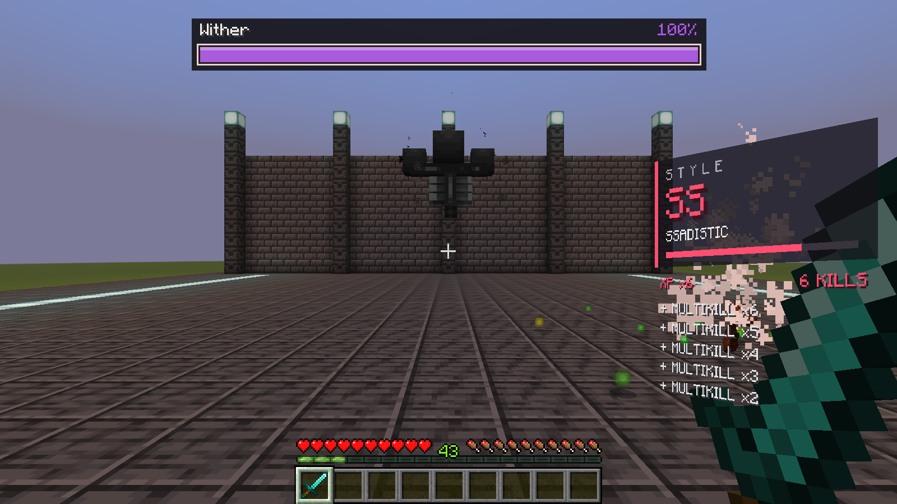
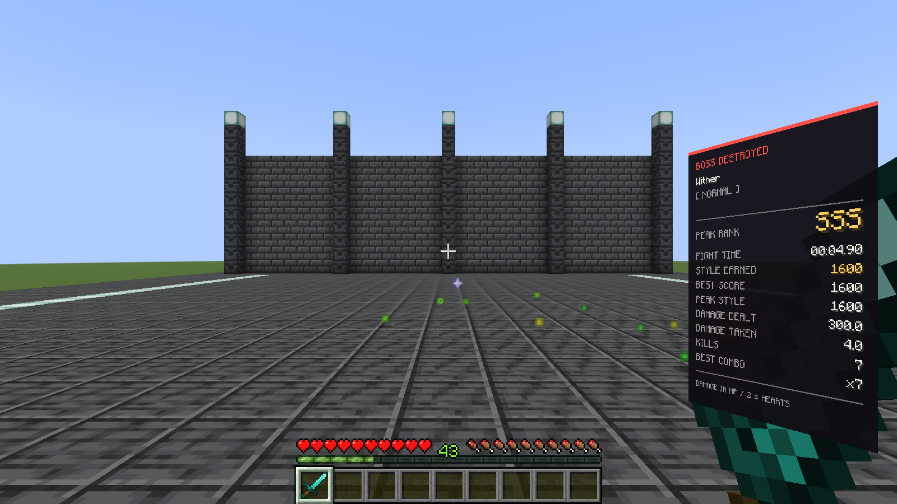
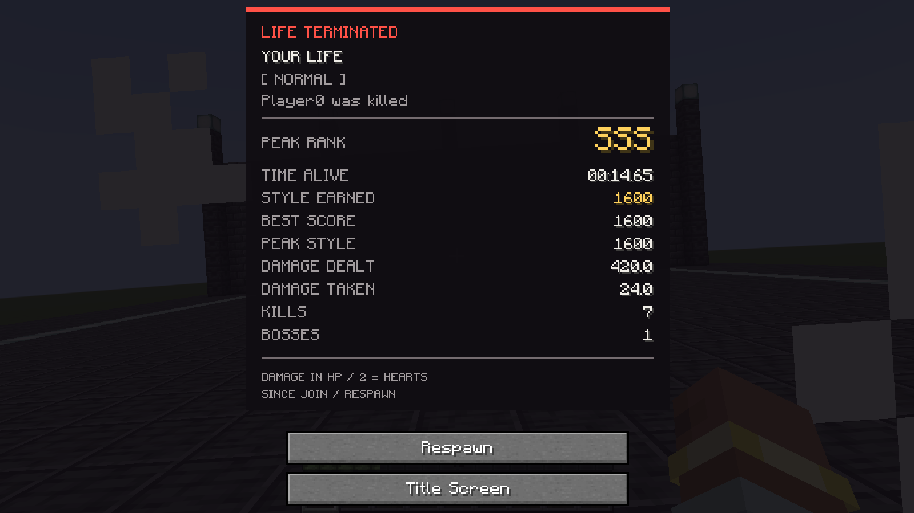

# UltraStyle

**Beta 0.1 — early prerelease with limited playtesting.** Expect bugs and compatibility issues; this is not a stable release.

A client-first Minecraft Java **26.3** mod built with **Fabric** and **Java 25**.
It adds an ULTRAKILL-inspired style display and boss bars, with rank-based XP multiplication in single-player. It uses original, code-drawn UI and Minecraft's font; no ULTRAKILL assets are bundled.

## Screenshots

Captured in Minecraft in a staged single-player arena, using the mod's actual HUD and combat tracking.

### Style meter and boss HUD

The perspective sidebar tracks rank, XP multiplier and multikills alongside the custom Wither health bar.



### Boss fight results

Defeating the Wither replaces the sidebar with the fight's score, peak rank, damage and personal best.



### Life summary

The death screen shows lifetime combat stats while retaining the Respawn and Title Screen buttons.



## Install and play

Install Fabric Loader 0.20.1 or newer for Minecraft 26.3, and Fabric API for that version.
Put `ultrastyle-0.1.0-beta.1.jar` from `build/libs/` into the client's `mods/` directory alongside Fabric API. Do not install the `-sources.jar`.

The mod does not need to be installed on multiplayer servers. It is explicitly client-only and should not be installed on a dedicated server.

## Features

- Right-side rank, progress meter, XP multiplier, multikill count, and fading action feed.
- The entire style panel is yawed 30 degrees into depth by default: its right edge appears nearer and taller, while vertical edges stay upright. Text and meter vertices share the same perspective projection; there is no screen-plane rotation. Its projected bounds stay inside the screen.
- Ranks D, C, B, A, S, SS, SSS, and ULTRAKILL provide XP multipliers ×1, ×2, ×3, ×4, ×5, ×6, ×7, and ×8 respectively. These are our Minecraft balancing values, not an exact recreation of ULTRAKILL mechanics.
- Hostile mob kills award 100 points; other mobs award 25.
- Consecutive kills within four seconds add 50 bonus points per combo step, capped at 200 bonus points per kill.
- Ordinary blocks award 1 point; blocks whose registry names end in `_ore`, plus ancient debris, award 20.
- Mining contributes at most 40 points per ten seconds. Creative/spectator mining and kills do not award points.
- Damage removes up to 100 style and ends the combo. Death clears style and combo, preserving the session total.
- Style decays by 10 per second after three seconds without a scoring action. Session totals never decay.
- Boss bars have thick outlines, server-provided colors and segments, a percentage, and a delayed damage trail. Multiple bars stack with an overflow count.
- F1 hides both overlays. Pausing single-player pauses score decay.

## Boss and life results

Defeating a boss you have engaged replaces the style sidebar with a compact results card for 15 seconds. It shares the HUD's depth projection and positioning. `/ultrastyle dismiss` returns to the style meter early. A new active boss fight takes priority over a previous results card.

The card shows boss name, difficulty at first contact, fight duration, style earned during the fight, personal-best score, peak style/rank, damage dealt to that boss, all damage taken during the encounter, kills and highest combo. Timing starts with the first damaging contact in either direction; a disappearing boss bar alone never counts as a kill. Leaving the dimension, unloading the boss or moving beyond 256 blocks abandons the encounter. Multiple engaged bosses have separate damage-dealt totals and share incoming damage and style earned during overlapping intervals.

Player death replaces the normal death-screen artwork and score text with the same results design, using lifetime stats: elapsed time, style earned, personal best, peak rank/style, outgoing/incoming damage, kills and boss kills. Life tracking begins on joining a world or respawning; it does **not** reconstruct activity from before this client session. The original vanilla buttons, keyboard navigation, activation delay, title-screen confirmation and hardcore **Spectate** behavior remain in place. The custom death screen remains available even with the style sidebar hidden.

Single-player damage totals measure actual health lost after mitigation, including fatal hits, capped by the victim's remaining health. Absorption/shield damage is excluded; 2 HP equals one heart. Multiplayer damage packets do not provide reliable amounts, so those rows display **N/A** and results are marked **OBSERVED**. Other multiplayer stats inherit the existing client-observation limitations.

The Ender Dragon and Wither are recognized by default. Add registry IDs to `bossEntityTypes` in `config/ultrastyle.json` for other boss entities; mods with custom combat/death implementations may require additional integration. Arbitrary command-created boss bars cannot reliably be associated with an entity.

Personal bests persist in `config/ultrastyle-records.json`, grouped by boss entity type (or life), starting difficulty and exact/observed mode, across worlds. Results are frozen at death; subsequent score decay cannot change them. `/ultrastyle reset` also starts a fresh statistics interval but keeps saved personal bests.

## Commands and configuration

These commands run locally and do not require operator permissions:

| Command | Effect |
| --- | --- |
| `/ultrastyle` | Show style multiplier, XP setting, and command hints |
| `/ultrastyle hud` | Toggle the style panel |
| `/ultrastyle tilt 30` | Set the depth angle immediately (−45 to 45 degrees); use 0 for a flat panel |
| `/ultrastyle bosses` | Toggle replacement boss bars; disabling restores vanilla bars |
| `/ultrastyle xp on` | Enable the rank-based XP multiplier in single-player (default) |
| `/ultrastyle xp off` | Restore normal XP gain while keeping the style HUD |
| `/ultrastyle reset` | Clear the local score session; already earned XP remains |
| `/ultrastyle reload` | Reload the configuration file |
| `/ultrastyle dismiss` | Dismiss the boss-results sidebar |

The current style rank multiplies **incoming XP points**, rather than converting score points into XP. For example, collecting 5 XP at rank A (×4) grants 20 XP total. The multiplier is enabled by default in single-player and applies once when XP is received, using the most recently published HUD rank. Damage, decay, and death lower it; earned XP is never removed.

Kills and block breaks still build style. Breaking dirt generates no XP by itself, while collecting ordinary XP from mobs, ores, furnaces, trading or bottles benefits from the current multiplier. Mending consumes its vanilla share before the remaining XP reaches the player and is multiplied. Positive XP-point grants from commands or mods using the standard player XP method also multiply; negative adjustments and level grants do not. Creative and spectator players are excluded.

The HUD shows `XP xN` when the single-player multiplier is enabled and `STYLE xN` when it is cosmetic. The kill streak is labeled separately to avoid confusing it with the XP multiplier. On remote servers, XP stays entirely server-controlled.

This replaces the earlier `/ultrastyle xp <number>` conversion. Old `singleplayerXp` and `xpPerPoint` fields are ignored; the new `styleXpEnabled` option defaults to true. Use `/ultrastyle xp off` to opt out. Saving a setting writes the new configuration format.

`config/ultrastyle.json` is created on first launch:

```json
{
  "bossEntityTypes": ["minecraft:ender_dragon", "minecraft:wither"],
  "hudEnabled": true,
  "bossBarsEnabled": true,
  "styleXpEnabled": true,
  "hudScale": 1.0,
  "hudYawDegrees": 30.0,
  "rightMargin": 12,
  "verticalOffset": 0
}
```

The previous `hudTiltDegrees` setting is ignored; `hudYawDegrees` now controls depth, so existing configurations automatically get the corrected perspective. Positive values bring the right edge forward; negative values reverse the depth.

Use `hudScale` (0.5–2), `rightMargin`, and `verticalOffset` to position the panel around other HUD mods or the server scoreboard. Scores are session-only: reconnecting or returning to the title screen resets them. Changing dimension preserves score but clears pending observations.

## Accuracy and current limitations

Single-player uses integrated-server block, damage, and death events. Kill credit includes vanilla's recent-player credit for indirect kills. Only the local player earns UltraStyle rewards, including in a world opened to LAN.

On remote servers, scoring is cosmetic and best effort. The client tracks damage packets attributed to you and requires an observed death notification within five seconds. It drops credit when a different known attacker damages the target. Disappearing entities do not count as kills. Some indirect kills, damage during invulnerability cooldowns, and server-specific combat mechanics may be missed or attributed differently from server statistics.

Remote block breaks wait half a second and require the block position to be air. This filters ordinary rejected breaks but cannot guarantee correctness on high-latency servers; waterlogged breaks that leave water are currently omitted. Multiplayer scores are not suitable for competitive verification.

Boss bars restyle the server's existing boss-bar data; they do not reveal extra entity health. Other mods that replace the same boss overlay may conflict; disable UltraStyle boss bars in that case. The style panel has manual positioning rather than automatic scoreboard avoidance.

## Develop

The Gradle wrapper is included; use JDK 25.

```sh
./gradlew build       # Compile, run unit tests, package the mod
./gradlew runClient   # Launch an isolated development client in run/
./gradlew genSources  # Generate Minecraft sources for IDE inspection
./gradlew runClientGameTest # Disposable-world boss/death/respawn integration test + screenshots
```

On Windows, use `gradlew.bat`. Generated output, development worlds, logs, caches, and local credentials are excluded by `.gitignore`; wrapper files remain trackable.

The pure Java scoring engine lives in `StyleState`. Client event handling, configuration and commands live in `UltraStyleClient`. `StyleHud` and `BossBars` draw the UI. Client mixins observe vanilla damage/death packets and replace boss-bar drawing. An integrated-server player mixin multiplies incoming XP using an immutable snapshot of the local player’s style rank; it never grants XP recursively or changes another LAN player’s XP. No custom network protocol is needed.

